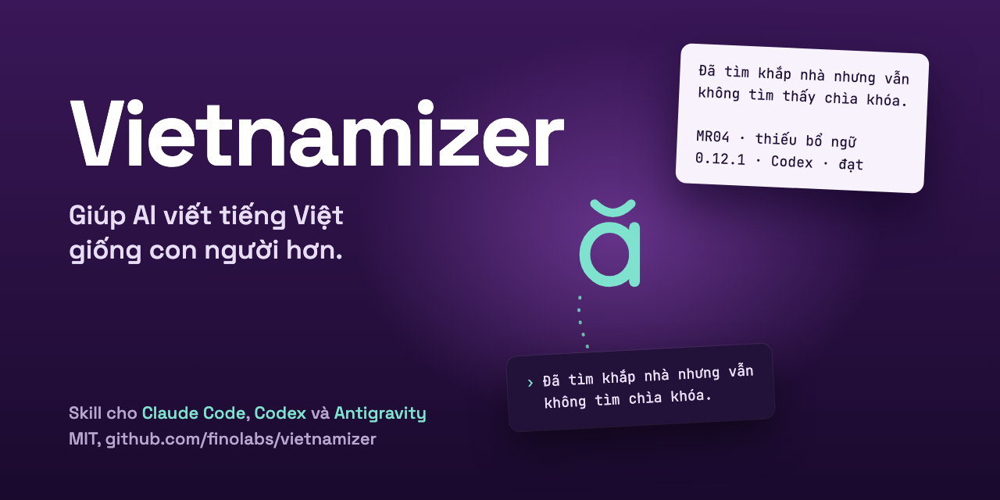

<p align="center">
  <picture>
    <source media="(prefers-color-scheme: dark)" srcset="assets/icon-dark.svg">
    
  </picture>
</p>

<h1 align="center">Vietnamizer</h1>

<p align="center"><strong>Biên tập tiếng Việt rõ ý, giữ nghĩa và giọng người viết.</strong><br>
Skill giúp Claude Code, Codex, Antigravity và các agent tương thích rà bản nháp AI, bản dịch sát và văn bản tiếng Việt đọc chưa thuận. Skill chọn quy tắc theo thể loại, chỉ sửa khi có căn cứ và kiểm lại nghĩa trước khi giữ thay đổi.</p>

<p align="center">
  <a href="https://github.com/finolabs/vietnamizer/releases/latest"></a>
  <a href="LICENSE"></a>
  <a href="https://github.com/finolabs/vietnamizer/actions/workflows/validate.yml"></a>
  <a href="#claude-code-plugin"></a>
  <a href="#codex-plugin"></a>
  <a href="#antigravity-plugin"></a>
</p>

<p align="center">
  
</p>

**Không cần API key cho core Markdown.** Mặc định giữ giọng gốc; khi được yêu cầu rõ,
có thể điều chỉnh theo mẫu người dùng cung cấp. Khả năng theo giọng mẫu vẫn đang được hiệu chỉnh.

[Cài nhanh](#cài-nhanh) · [Xem bằng chứng](#bằng-chứng-và-kiểm-thử) · [Dùng ngay](#dùng-ngay) · [Tài liệu](#tài-liệu-chi-tiết)

## Vietnamizer hữu ích ở đâu?

| Khi cần | Skill hướng agent làm gì? |
|---|---|
| Rà bản nháp AI hoặc bản dịch sát | Tìm lỗi cụ thể về từ, bổ ngữ và cấu trúc câu |
| Biên tập blog, bài chuyên môn | Giữ ý định, mức khẳng định, câu rút gọn và nhịp dấu câu |
| Rà README, báo cáo, tài liệu công việc | Giữ thuật ngữ và giọng theo thể loại |
| Biên tập theo giọng mẫu | Dùng đặc tính có bằng chứng, kiểm riêng việc thêm/bỏ hoặc đổi ý |

Dùng như một bước biên tập có kiểm soát trước khi gửi hoặc xuất bản. Đọc lại những chỗ
đổi xưng hô, cấu trúc và dấu câu; skill không xác minh sự thật trong bài.

## Cài nhanh

Gõ một lệnh trong terminal, theo host bạn dùng, rồi mở session mới:

Claude Code:

```bash
claude plugin marketplace add finolabs/plugins && claude plugin install vietnamizer@finolabs
```

Codex:

```bash
codex plugin marketplace add finolabs/plugins && codex plugin add vietnamizer@finolabs
```

Antigravity:

```bash
agy plugin install https://github.com/finolabs/vietnamizer
```

Agent khác đọc được Agent Skills:

```bash
npx skills add finolabs/vietnamizer --skill vietnamizer
```

Chỉ chọn một cách, plugin hoặc skill lẻ. Chi tiết từng host ở [Cài đặt theo nền tảng](#cài-đặt-theo-nền-tảng).

## Trước/sau: sửa chỗ cần sửa, giữ chỗ đã đúng

Trích đầu ra thật trên cùng Codex trong lượt hồi quy **0.12.0/0.12.1** ngày 27/10/2026.
Bảng chỉ hiển thị phần liên quan; kết quả này không phải phép đo mới cho 0.13.2.

| Ca | Bản gốc | Sau biên tập với 0.12.1 |
|---|---|---|
| MR04 · thiếu bổ ngữ | Đã tìm khắp nhà nhưng vẫn không tìm chìa khóa. | Đã tìm khắp nhà nhưng vẫn không tìm **thấy** chìa khóa. |
| MR05 · điểm ngắt có chức năng | Tất cả – chỉ khác là… | Giữ nguyên điểm ngắt; 0.12.0 đã đổi thành dấu phẩy. |
| MR12 · đối tượng đã rõ | Tôi đang soạn hướng dẫn bàn giao. Soạn xong rồi dừng. | Giữ nguyên; 0.12.0 đã thêm “bản hướng dẫn” vào câu sau. |

Ở MR04, ngữ cảnh là đã tìm nhưng chưa thấy. MR05 không có quy chuẩn buộc đổi dấu;
MR12 đã rõ đối tượng từ câu trước. [Xem đủ ca và tiêu chí](specs/018-mr-version-comparison/results.md).

## Bằng chứng và kiểm thử

**Có bằng chứng hồi quy về sửa lỗi và tránh sửa quá tay; chưa có chấm người độc lập.**
Các phép so sánh dưới đây dùng cùng agent biên tập, không xếp hạng Codex với Gemini.

### Hồi quy: hai ca sửa quá tay đã được khắc phục trong lượt đối chiếu

<picture>
  <source media="(max-width: 600px)" srcset="docs/figures/regression-cases-mobile.svg">
  
</picture>

**12 ca, 14 tình huống × 2 phiên bản = 28 đầu ra.** MR05 và MR12 chuyển từ chưa đạt sang đạt;
không ca nào chuyển ngược trong lượt này. Đây là tập phát triển đã dùng để sửa skill,
mỗi điều kiện sinh một lần; nhãn do agent đối chiếu và reviewer kiểm tra.
**12/12 không có nghĩa 100% văn bản sẽ được sửa đúng.**
[Xem báo cáo hồi quy](specs/018-mr-version-comparison/results.md).

### Theo giọng mẫu: có tín hiệu tốt, kết quả còn trái chiều

<picture>
  <source media="(max-width: 600px)" srcset="docs/figures/reference-voice-mobile.svg">
  
</picture>

Cả hai hàng là **model chấm ẩn nhãn**, cùng đánh giá đầu ra do **Codex biên tập**.
So sánh dùng cùng bản gốc, mẫu giọng và yêu cầu theo mẫu. Mỗi hàng có tám nguồn dự kiến;
phiếu V2–Gemini bị loại do trích dẫn sai và giữ ở trạng thái thiếu.

Hai giám khảo đồng ý lựa chọn ở **4/7 nguồn cùng có phiếu**. Corpus đã được dùng để
hiệu chỉnh skill; model chấm không thay thế tác giả hoặc người đọc. Chưa đủ bằng chứng
Vietnamizer luôn tốt hơn prompt thông thường kèm mẫu.
[Xem pilot 0.13.2](specs/025-section-voice-pilot/results.md) · [Phương pháp, dữ liệu và mọi đợt đánh giá](docs/benchmarks.md).

**Kết luận thực dụng:** đáng thử khi cần một quy trình rà tiếng Việt có quy tắc rõ và
kiểm soát sửa quá tay. Với yêu cầu theo giọng mẫu, cần đọc lại từng bản sửa.
Không dùng mức đổi ký tự, độ dài hay token làm điểm chất lượng.

## Dùng ngay

1. Nhờ trợ lý AI của bạn cài Vietnamizer từ repo này, hoặc chạy lệnh ở mục [Cài nhanh](#cài-nhanh).
2. Mở session mới rồi gõ `/vietnamizer:help` (plugin trên Claude Code) hoặc hỏi “Vietnamizer làm được gì?”.
3. Giao bản nháp như ví dụ dưới; skill đã chạy khi câu trả lời là bản đã biên tập, giữ nguyên dữ kiện và
   thuật ngữ.

Gọi `Vietnamizer` và giao bản nháp, thể loại, người đọc cùng phần cần bảo toàn. Ví dụ:

```text
Use Vietnamizer to copyedit the Vietnamese draft below for a personal blog.
Preserve its meaning, level of certainty, terminology and existing voice.
Keep quotations and code unchanged. Return only the edited article.

<draft>Paste your draft here.</draft>
```

Có thể yêu cầu bảng trước/sau và lý do thay đổi. [Prompt theo tình huống và cách trả kết quả](docs/usage.md).

## Cho AI agent: cài và thiết lập

Người dùng đưa link repo này và nhờ bạn cài. Làm theo thứ tự:

1. **Xác định host**: Claude Code, Codex, Antigravity hoặc một agent khác đọc được Agent Skills.
2. **Hỏi người dùng trước khi cài.** Plugin áp dụng cho mọi dự án của họ. Chỉ cài một trong hai cách, plugin hoặc skill lẻ, vì cài cả hai thì skill sẽ hiện hai lần.
3. **Kiểm tra bản đã cài**: chạy `claude plugin list` hoặc `codex plugin list`. Nếu `vietnamizer` đã có từ catalog khác (`vietnamizer@vietnamizer` hoặc catalog `Finolabs` cũ), dừng lại và hỏi người dùng; các bước nằm trong [hướng dẫn chuyển](docs/installation.md#codex-plugin).
4. **Cài** bằng lệnh của host:

   | Host | Lệnh |
   | --- | --- |
   | Claude Code | `claude plugin marketplace add finolabs/plugins`, rồi `claude plugin install vietnamizer@finolabs` |
   | Codex | `codex plugin marketplace add finolabs/plugins`, rồi `codex plugin add vietnamizer@finolabs` |
   | Antigravity | `agy plugin install https://github.com/finolabs/vietnamizer` |
   | Agent khác | `npx skills add finolabs/vietnamizer --skill vietnamizer` |

5. **Kiểm tra** `claude plugin list`, `codex plugin list` hoặc `agy plugin list` đã liệt kê `vietnamizer`, rồi báo nguyên văn kết quả cho người dùng, kể cả khi lỗi.
6. **Bàn giao**: nhắc người dùng mở session mới, rồi giao một bản nháp như ví dụ ở mục [Dùng ngay](#dùng-ngay).

Xong khi host liệt kê `vietnamizer` và người dùng biết phải mở session mới.

## Giữ giọng khi có mẫu

Chỉ gửi mẫu chưa tự bật chuyển giọng. Để điều chỉnh theo mẫu, yêu cầu rõ việc đó và
cung cấp mẫu/hồ sơ ngay trong tác vụ. Skill có thể đổi cách diễn đạt hoặc cấu trúc từ
các ý đã có, vẫn phải giữ mệnh đề, điều kiện, mức chắc chắn và vùng bảo toàn.

Skill không tự tìm/lưu hồ sơ cá nhân hoặc tạo trải nghiệm thay người viết; chỉ tuyến hồ sơ giọng tùy chọn mới lưu hồ sơ, khi bạn yêu cầu rõ.
Hồ sơ có thể là giọng cá nhân (mặc định) hoặc giọng thương hiệu, mỗi lần dùng một hồ sơ; học từ bài bạn dán,
file export LinkedIn/Facebook hoặc trang của chính bạn qua trình duyệt của host, còn giọng thương hiệu học
từ bộ quy chuẩn, bài đã đăng và tài liệu nội bộ bạn đưa, hoặc đọc fanpage, trang công ty LinkedIn hay blog
của thương hiệu qua trình duyệt từ URL bạn đưa (tối đa ba trang, mỗi trang một câu đồng ý); Trang Facebook của chính bạn (nghệ sĩ, người nổi tiếng) học được thành hồ sơ cá nhân sau cảnh báo và xác nhận. Sau khi học, bạn có thể chấm vài đoạn mẫu theo
bốn mức Kém, Trung bình, Khá, Tốt; số lượt chấm chỉ vào hồ sơ khi bạn lưu, ghi là đánh giá của bạn. Skill
không tự tính điểm giống giọng. Gõ `/vietnamizer:help` (plugin trên Claude Code) hoặc hỏi “Vietnamizer làm được gì?” để xem
hướng dẫn và bắt đầu thiết lập giọng.
[Xem hai chế độ, ví dụ prompt và bảy style card](docs/style-and-voice.md).

## Nền tảng hỗ trợ

Không phụ thuộc hệ điều hành: gói chỉ gồm Markdown, không có mã chạy riêng, nên chạy ở nơi host chạy
(macOS, Linux hay Windows, tùy host). Script đóng gói trong repo cần Bash và Python 3.

| Host | Cách cài | Ghi chú |
| --- | --- | --- |
| Claude Code | Plugin từ catalog `finolabs/plugins` | Có thêm `/vietnamizer:help` |
| Codex | Plugin từ catalog `finolabs/plugins` | |
| Antigravity | Plugin từ URL repo | Không có catalog |
| Claude web, Claude Desktop, Claude Org | Skill lẻ hoặc marketplace | Xem [Cài đặt](docs/installation.md) |
| Agent khác đọc được Agent Skills | `npx skills add` | |

## Cài đặt theo nền tảng

Bản hiện tại là **0.16.0**. [Tải các gói từ GitHub Release](https://github.com/finolabs/vietnamizer/releases/latest).

### Skills CLI

```bash
npx skills add finolabs/vietnamizer --skill vietnamizer
```

### Codex plugin

```bash
codex plugin marketplace add finolabs/plugins
codex plugin add vietnamizer@finolabs
```

Đã đăng ký catalog `Finolabs` cũ hoặc `vietnamizer@vietnamizer`? Đọc
[hướng dẫn chuyển](docs/installation.md#codex-plugin) trước khi đổi đăng ký.
**Finolabs** là catalog dùng chung; không phải chứng nhận từ OpenAI.

### Claude Code plugin

```bash
claude plugin marketplace add finolabs/plugins
claude plugin install vietnamizer@finolabs
```

### Antigravity plugin

```bash
agy plugin install https://github.com/finolabs/vietnamizer
```

Mở session mới sau khi cài. [Claude web/Desktop, Claude Org, cài thủ công và đóng gói](docs/installation.md).

## Quyền riêng tư

Skill không có mã gọi mạng và không đọc API key. Văn bản bạn giao đi qua host bạn đang dùng, theo chính
sách của host đó. Hồ sơ giọng chỉ được lưu khi bạn yêu cầu rõ, tại nơi bạn chọn; đường đọc trang qua
trình duyệt chỉ chạy khi host có công cụ trình duyệt và sau câu đồng ý của bạn. Không muốn thì không dùng
tuyến hồ sơ giọng, hoặc chọn dán bài. [Chi tiết trong PRIVACY.md](PRIVACY.md).

## Phạm vi

- Tự chọn profile theo thể loại; công văn, hợp đồng, thơ và changelog chỉ rà typography.
- Bảo toàn dữ kiện, thuật ngữ, code và trích dẫn nguyên văn; không suy tác giả AI từ lỗi ngôn ngữ.
- Không gọi dịch vụ ngoài và không đọc API key; Jev/TypeSafe đã gỡ từ 0.14.0.
- Chỉ cung cấp văn bản được phép chia sẻ, không chứa credential hoặc dữ liệu bị hạn chế.

[Xem xử lý dữ liệu](docs/usage.md) · [Quyền riêng tư](PRIVACY.md) · [Báo lỗi bảo mật](SECURITY.md).

## Danh mục pattern

| Nhóm | Số lượng | Phạm vi |
|---|---:|---|
| V1–V25 | 25 | Cách dùng từ và cấu trúc câu |
| T1–T6 | 6 | Typography |
| B1–B17 | 17 | Blog, bài cá nhân, nội dung công việc và marketing |
| K1–K7 | 7 | Tài liệu kỹ thuật, doanh nghiệp và học thuật |

**55 pattern.** [Danh mục đầy đủ](docs/patterns.md); quy tắc chuẩn nằm trong `SKILL.md` và `profiles/`.

## Tài liệu chi tiết

| Cần tìm | Tài liệu |
|---|---|
| Cài đặt theo nền tảng, marketplace và đóng gói | [Cài đặt](docs/installation.md) |
| Prompt, phạm vi và dữ liệu | [Sử dụng](docs/usage.md) |
| Giữ giọng gốc, theo mẫu, tuyến hồ sơ giọng tùy chọn và chọn phong cách | [Giọng và phong cách](docs/style-and-voice.md) |
| Cây nguồn, các tầng quy tắc và thành phần | [Kiến trúc](docs/architecture.md) |
| Tên và vai trò của từng pattern | [Danh mục 55 pattern](docs/patterns.md) |
| Phương pháp, giới hạn và các kết quả benchmark | [Benchmark](docs/benchmarks.md) |
| Tài liệu tham khảo và mức độ tin cậy | [Nguồn và ghi nhận](docs/sources.md) |
| Thay đổi qua từng phiên bản | [Changelog](docs/changelog.md) |

## Lịch sử phiên bản

- **0.16.0** — Hồ sơ giọng thương hiệu đọc được fanpage Facebook, trang công ty LinkedIn hoặc blog của thương hiệu qua trình duyệt của host, từ tối đa ba URL bạn đưa, mỗi URL một câu đồng ý gọi tên thương hiệu và URL; chỉ đọc thân bài thương hiệu đã đăng, từ chối trang đối thủ, dừng khi trang không mang tên thương hiệu bạn nêu. Constitution lên 2.6.0. Chưa chạy agent trên các ca mới. [Lịch sử đầy đủ](docs/changelog.md)
- **0.15.0** — Hồ sơ giọng có hai loại, cá nhân (mặc định) và thương hiệu, mỗi lần chỉ áp một; học giọng từ bài dán, file export LinkedIn/Facebook hoặc trang của chính bạn qua trình duyệt (có cảnh báo điều khoản nền tảng); chấm đoạn mẫu bốn mức sau khi học; thêm skill `help` và bước thiết lập; hồ sơ giọng có `ranh giới` và `Điểm chưa quyết`; tên file trong gói đổi sang tiếng Anh (xem bảng trong changelog). Giữ 55 pattern và năm chốt. [Lịch sử đầy đủ](docs/changelog.md)
- **0.14.0** — Gỡ Jev (evaluator TypeSafe): skill không còn gọi dịch vụ ngoài hay đọc API key; gói chỉ gồm Markdown và script đóng gói. Giữ 55 pattern, năm chốt và tuyến hồ sơ giọng opt-in. [Lịch sử đầy đủ](docs/changelog.md)
- **0.13.4** — Thêm tuyến hồ sơ giọng cá nhân tùy chọn (chỉ lưu khi bạn yêu cầu rõ); gói phát hành bỏ `calibration/`; phân phối qua catalog `finolabs/plugins`. Giữ 55 pattern và runtime. [Lịch sử đầy đủ](docs/changelog.md)

## Đóng góp

[Gửi ca sửa sai hoặc góp mã](CONTRIBUTING.md) · [Issues](https://github.com/finolabs/vietnamizer/issues) · [Điều khoản](TERMS.md).

## Giấy phép

MIT. Xem [LICENSE](LICENSE). Fioenix / FINOLABS.
