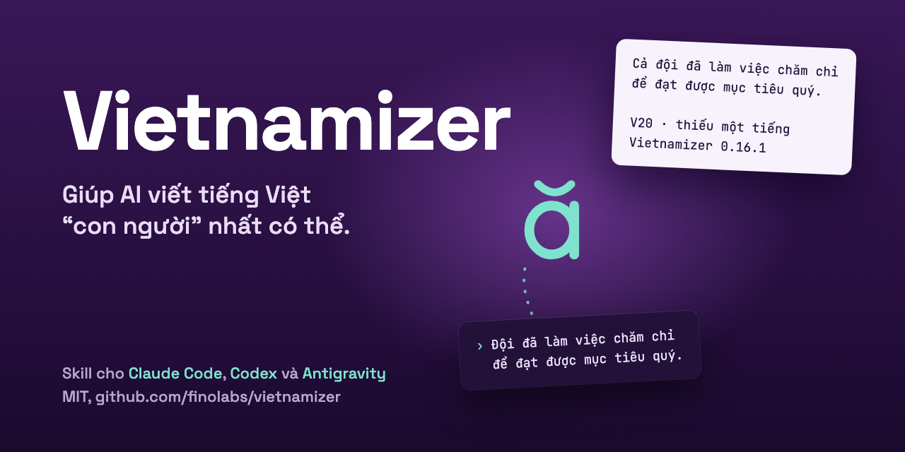
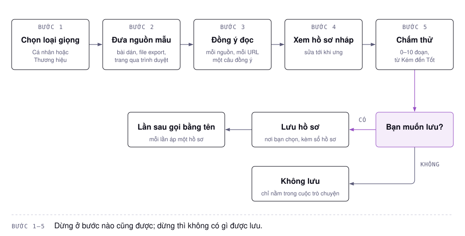
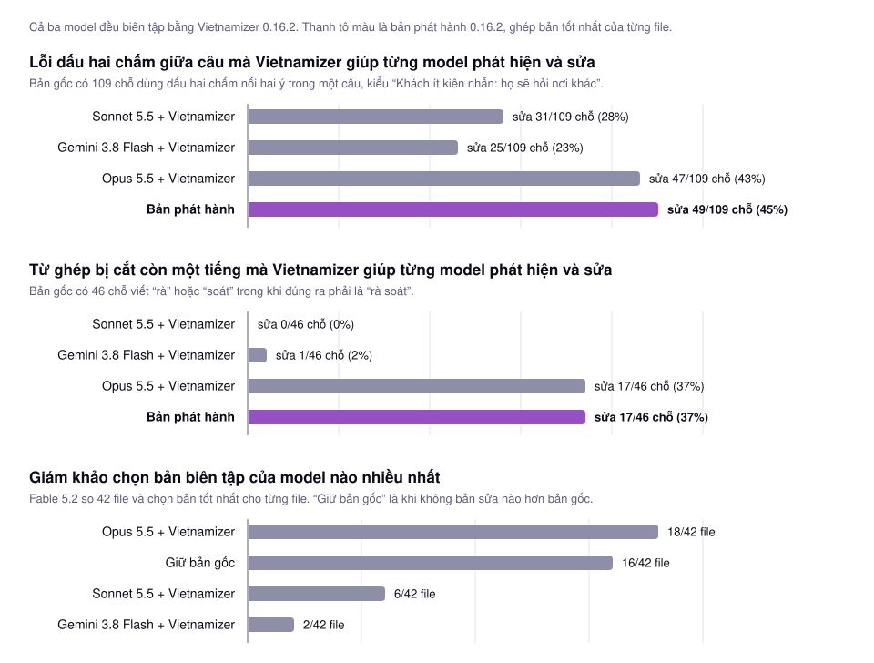

<p align="center">
  <picture>
    <source media="(prefers-color-scheme: dark)" srcset="assets/icon-dark.svg">
    
  </picture>
</p>

<h1 align="center">Vietnamizer</h1>

<p align="center"><strong>Giúp AI viết tiếng Việt “con người” nhất có thể.</strong><br>
Skill cho Claude Code, Codex, Antigravity và các agent đọc được Agent Skills. Vietnamizer giúp biên tập bản nháp AI và bản dịch thô, nhận diện lỗi qua các pattern chuẩn, giữ ngữ nghĩa và giọng văn người viết.</p>

<p align="center">
  <a href="https://github.com/finolabs/vietnamizer/releases/latest"></a>
  <a href="LICENSE"></a>
  <a href="https://github.com/finolabs/vietnamizer/actions/workflows/validate.yml"></a>
  <a href="#claude-code-plugin"></a>
  <a href="#codex-plugin"></a>
  <a href="#antigravity-plugin"></a>
</p>

<p align="center">
  
</p>

Tôi viết Vietnamizer riêng cho tiếng Việt, không dịch lại từ một skill tiếng Anh nào. LLM học phần lớn
từ dữ liệu tiếng Anh nên câu chữ tiếng Việt AI viết ra thường thô cứng. Khó nhất là sửa sao cho giữ trọn
ý mà vẫn “con người”. Vì vậy Vietnamizer mặc định giữ giọng của bài và chỉ sửa chỗ nhận ra lỗi. Khi bạn
muốn, nó học giọng của bạn hoặc của thương hiệu bạn được nói thay rồi viết theo giọng đó. README này cũng
đã qua tay nó, theo hồ sơ giọng của tôi. Tôi tin càng kiên nhẫn hiệu chỉnh hồ sơ giọng thì AI viết càng
gần với chính bạn, nhưng đó là niềm tin chứ chưa phải số đo, nên bạn vẫn nên đọc lại từng bản sửa.

**Không cần API key; gói không có mã gọi mạng.** Văn bản vẫn đi qua host bạn dùng
([Quyền riêng tư](#quyền-riêng-tư)).

[Cài nhanh](#cài-nhanh) · [Dùng ngay](#dùng-ngay) · [Thiết lập giọng](#thiết-lập-giọng-của-bạn) · [Tài liệu](#tài-liệu-chi-tiết)

## Vietnamizer hữu ích ở đâu?

| Khi cần | Skill hướng agent làm gì? |
|---|---|
| Biên tập bản nháp AI hoặc bản dịch thô | Tìm lỗi cụ thể về từ, bổ ngữ và cấu trúc câu |
| Biên tập blog, bài chuyên môn | Giữ ý định, mức khẳng định, câu rút gọn và nhịp dấu câu |
| Rà soát README, báo cáo, tài liệu công việc | Giữ thuật ngữ và giọng theo thể loại |
| Viết theo giọng của bạn hoặc của thương hiệu | Học hồ sơ giọng từ bài bạn đưa, cho bạn chấm đoạn mẫu, chỉ lưu khi bạn yêu cầu; bắt đầu bằng `/vietnamizer:help` (Claude Code) hoặc câu “thiết lập giọng” |

Vietnamizer là bước biên tập trước khi gửi hay đăng bài và không kiểm chứng dữ kiện trong bài.

## Cài nhanh

Gõ một lệnh trong terminal, theo host bạn dùng, rồi mở session mới:

Claude Code:

```bash
claude plugin marketplace add finolabs/plugins && claude plugin install vietnamizer@finolabs
```

Codex:

```bash
codex plugin marketplace add finolabs/plugins && codex plugin add vietnamizer@finolabs
```

Antigravity:

```bash
agy plugin install https://github.com/finolabs/vietnamizer
```

Agent khác đọc được Agent Skills:

```bash
npx skills add finolabs/vietnamizer --skill vietnamizer
```

Chỉ chọn một cách, plugin hoặc skill lẻ. Chi tiết từng host ở [Cài đặt theo nền tảng](#cài-đặt-theo-nền-tảng).

## Dùng ngay

1. Nhờ trợ lý AI của bạn cài Vietnamizer từ repo này, hoặc chạy lệnh ở mục [Cài nhanh](#cài-nhanh).
2. Mở session mới. Trên Claude Code, gõ `/vietnamizer:help`; ở host khác, hỏi “Vietnamizer làm được gì?”.
3. Giao một bản nháp, nói rõ bài dùng cho đâu và phần nào không được đổi. Bạn nhận lại bản đã biên tập mà
   dữ kiện và thuật ngữ vẫn nguyên, tức là skill đã chạy.

```text
Dùng Vietnamizer biên tập bài blog cá nhân dưới đây.
Giữ nguyên ý, mức chắc chắn, thuật ngữ và giọng hiện có.
Không sửa trích dẫn và code. Chỉ trả lại bài đã biên tập.

<draft>Dán bản nháp vào đây.</draft>
```

Prompt tiếng Anh cũng được. [Prompt theo tình huống và cách trả kết quả](docs/usage.md).

## Thiết lập giọng của bạn

Bước này không bắt buộc. Chưa có hồ sơ giọng, Vietnamizer vẫn biên tập và giữ giọng sẵn có của bài.
Muốn skill nhớ giọng của bạn, hoặc của thương hiệu bạn được nói thay, qua nhiều lần dùng thì chỉ việc
nói “Thiết lập giọng” là được (trên Claude Code có thêm `/vietnamizer:help`).

<picture>
  <source media="(prefers-color-scheme: dark)" srcset="docs/figures/voice-setup-dark.svg">
  
</picture>

1. **Loại giọng.** Cá nhân (mặc định) hoặc Thương hiệu.
2. **Nguồn mẫu.** 10–20 bài bạn tự viết, file export LinkedIn hay Facebook, hoặc trang của chính bạn hay
   của thương hiệu qua trình duyệt của host (tối đa ba URL).
3. **Đồng ý đọc.** Mỗi nguồn, mỗi URL một câu đồng ý. Skill không kiểm được tài khoản có phải của bạn hay bạn
   có được nói thay thương hiệu không, nên tin lời bạn. Trước khi đọc Facebook hay LinkedIn, skill nhắc rằng điều khoản nền tảng cấm thu thập
   tự động khi chưa được phép.
4. **Hồ sơ nháp.** Mỗi nét giọng có phạm vi, căn cứ và mức chắc chắn. Bạn sửa tới khi ưng.
5. **Chấm thử.** Từ 0 đến 10 đoạn mẫu, mỗi đoạn chấm Kém, Trung bình, Khá hoặc Tốt. Kết quả là đánh giá
   của riêng bạn, không phải điểm đo chất lượng.
6. **Lưu.** Chỉ lưu khi bạn yêu cầu, vào Orrery, Obsidian hoặc một thư mục Markdown (gợi ý
   `~/.agents/vietnamizer/profiles`), kèm tên trong sổ hồ sơ `~/.agents/vietnamizer/registry.md`. Trong Cowork
   trên máy, hồ sơ và sổ lưu được ngay trong thư mục project, ở `.vietnamizer/`. Trên Chat, hồ sơ thành bản gọn
   trong bộ nhớ của Chat sau khi bạn đồng ý, và nếu connector Google Drive đang bật thì lưu thêm được bản đầy đủ
   vào Drive của bạn ([PRIVACY.md](PRIVACY.md)).

Lần sau, gọi hồ sơ bằng tên, ví dụ `/vietnamizer:vietnamizer giong-cong-viec` (plugin Claude Code),
`$vietnamizer giong-cong-viec` (Codex), hoặc nói “Viết lại bài này theo hồ sơ giong-cong-viec”. Dùng
`cá nhân` thay cho tên để gọi hồ sơ cá nhân mặc định. Mỗi lần chỉ áp một hồ sơ, và hồ sơ không được đổi
nghĩa của bài. [Hai chế độ giữ giọng và cách gọi hồ sơ trên từng host](docs/style-and-voice.md).

## Trước/sau: sửa chỗ cần sửa, giữ chỗ đã đúng

Trích đầu ra thật trên Codex, lượt hồi quy 0.12.0/0.12.1 ngày 27/10/2026; các bản sau chưa đo lại.

| Ca | Bản gốc | Sau biên tập với 0.12.1 |
|---|---|---|
| MR04 · thiếu bổ ngữ | Đã tìm khắp nhà nhưng vẫn không tìm chìa khóa. | Đã tìm khắp nhà nhưng vẫn không tìm **thấy** chìa khóa. |
| MR05 · điểm ngắt có chức năng | Tất cả – chỉ khác là… | Giữ nguyên điểm ngắt; 0.12.0 đã đổi thành dấu phẩy. |
| MR12 · đối tượng đã rõ | Tôi đang soạn hướng dẫn bàn giao. Soạn xong rồi dừng. | Giữ nguyên; 0.12.0 đã thêm “bản hướng dẫn” vào câu sau. |

[Xem đủ ca và tiêu chí](specs/018-mr-version-comparison/results.md) · [Benchmark](docs/benchmarks.md).

## Vietnamizer tự biên tập chính nó (0.16.2)

Ba model dùng Vietnamizer 0.16.2 biên tập lại 42 file của chính gói skill, theo hồ sơ giọng của tác giả. Fable 5.2 so từng file với bản gốc và chọn bản tốt nhất.

Khi dùng Vietnamizer, cả ba model đều phát hiện và sửa được lỗi dấu hai chấm giữa câu. Với từ ghép bị cắt còn một tiếng như *rà*, *soát* thì Opus sửa được 17 trên 46 chỗ, Gemini 1 chỗ, còn Sonnet không sửa được chỗ nào. Fable 5.2 cũng dùng Vietnamizer để chọn bản tốt nhất cho từng file rồi ghép lại thành bản phát hành, nên sửa được nhiều nhất dù không tự viết câu nào.

<picture>
  <source media="(prefers-color-scheme: dark)" srcset="docs/figures/self-edit-benchmark-dark.svg">
  
</picture>

<details>
<summary>Bảng số liệu</summary>

| | Bản gốc | Sonnet 5.5 + Vietnamizer | Gemini 3.8 Flash + Vietnamizer | Opus 5.5 + Vietnamizer | Fable 5.2 + Vietnamizer (bản phát hành) |
|---|---|---|---|---|---|
| File được sửa | | 23 | 28 | 23 | 27 |
| Dấu hai chấm giữa câu | 109 | 78 | 84 | 62 | 60 |
| *rà*, *soát* đứng một mình | 46 | 46 | 45 | 29 | 29 |
| File bản phát hành lấy bản này | 16 | 6 | 2 | 18 | |

</details>

[Phương pháp đếm và cách chạy lại](docs/benchmarks.md#vietnamizer-tự-biên-tập-chính-nó-0162).

## Cho AI agent: cài và thiết lập

Người dùng đưa link repo này và nhờ bạn cài. Làm theo thứ tự:

1. **Xác định host**: Claude Code, Codex, Antigravity hoặc một agent khác đọc được Agent Skills.
2. **Hỏi người dùng trước khi cài.** Plugin áp dụng cho mọi dự án của họ. Chỉ cài một trong hai cách, plugin hoặc skill lẻ, vì cài cả hai thì skill sẽ hiện hai lần.
3. **Kiểm tra bản đã cài**: chạy `claude plugin list` hoặc `codex plugin list`. Nếu `vietnamizer` đã có từ catalog khác (`vietnamizer@vietnamizer` hoặc catalog `Finolabs` cũ), dừng lại và hỏi người dùng; các bước nằm trong [hướng dẫn chuyển](docs/installation.md#codex-plugin).
4. **Cài** bằng lệnh của host:

   | Host | Lệnh |
   | --- | --- |
   | Claude Code | `claude plugin marketplace add finolabs/plugins`, rồi `claude plugin install vietnamizer@finolabs` |
   | Codex | `codex plugin marketplace add finolabs/plugins`, rồi `codex plugin add vietnamizer@finolabs` |
   | Antigravity | `agy plugin install https://github.com/finolabs/vietnamizer` |
   | Agent khác | `npx skills add finolabs/vietnamizer --skill vietnamizer` |

5. **Kiểm tra** `claude plugin list`, `codex plugin list` hoặc `agy plugin list` đã liệt kê `vietnamizer`, rồi báo nguyên văn kết quả cho người dùng, kể cả khi lỗi.
6. **Bàn giao**: nhắc người dùng mở session mới, rồi giao một bản nháp như ví dụ ở mục [Dùng ngay](#dùng-ngay), hoặc nói “thiết lập giọng” nếu muốn dựng hồ sơ giọng ([Thiết lập giọng của bạn](#thiết-lập-giọng-của-bạn)).

Xong khi host liệt kê `vietnamizer` và người dùng biết phải mở session mới.

## Nền tảng hỗ trợ

Gói chỉ gồm Markdown, profile, asset và manifest, không có script nào, nên skill chạy trên mọi hệ điều
hành mà host chạy (macOS, Linux, Windows). Các script
đóng gói và kiểm tra trong repo cần Bash và Python 3; chúng không nằm trong gói.

| Host | Cách cài | Ghi chú |
| --- | --- | --- |
| Claude Code | Plugin từ catalog `finolabs/plugins` | Có thêm `/vietnamizer:help` |
| Codex | Plugin từ catalog `finolabs/plugins` | |
| Antigravity | Plugin từ URL repo | Không có catalog |
| Claude web, Claude Desktop, Claude Org | Skill lẻ hoặc marketplace | Xem [Cài đặt](docs/installation.md) |
| Agent khác đọc được Agent Skills | `npx skills add` | |

## Cài đặt theo nền tảng

Bản hiện tại là **0.16.3**. [Tải các gói từ GitHub Release](https://github.com/finolabs/vietnamizer/releases/latest).

### Skills CLI

```bash
npx skills add finolabs/vietnamizer --skill vietnamizer
```

### Codex plugin

```bash
codex plugin marketplace add finolabs/plugins
codex plugin add vietnamizer@finolabs
```

Đã đăng ký catalog `Finolabs` cũ hoặc `vietnamizer@vietnamizer`? Đọc
[hướng dẫn chuyển](docs/installation.md#codex-plugin) trước khi đổi đăng ký.
**Finolabs** là catalog dùng chung; không phải chứng nhận từ OpenAI.

### Claude Code plugin

```bash
claude plugin marketplace add finolabs/plugins
claude plugin install vietnamizer@finolabs
```

### Antigravity plugin

```bash
agy plugin install https://github.com/finolabs/vietnamizer
```

Mở session mới sau khi cài. [Claude web/Desktop, Claude Org, cài thủ công và đóng gói](docs/installation.md).

## Quyền riêng tư

Gói không có mã gọi mạng và không đọc API key. Văn bản bạn giao đi qua host bạn đang dùng, theo chính
sách của host đó. Hồ sơ giọng chỉ được lưu khi bạn yêu cầu, tại nơi bạn chọn. Đọc trang qua trình duyệt chỉ
chạy khi host có công cụ trình duyệt và sau khi bạn đồng ý; khi đó công cụ của host mở trang bên ngoài.
Skill không kiểm được tài khoản hay quyền nói thay thương hiệu nên tin lời bạn; không muốn thì chọn dán bài.
[Chi tiết trong PRIVACY.md](PRIVACY.md).

## Phạm vi

- Tự chọn profile theo thể loại; công văn, hợp đồng, thơ và changelog chỉ rà soát typography.
- Bảo toàn dữ kiện, thuật ngữ, code và trích dẫn nguyên văn; không suy tác giả AI từ lỗi ngôn ngữ.
- Không gọi dịch vụ ngoài và không đọc API key; Jev/TypeSafe đã gỡ từ 0.14.0.
- Chỉ cung cấp văn bản được phép chia sẻ, không chứa credential hoặc dữ liệu bị hạn chế.

[Xem xử lý dữ liệu](docs/usage.md) · [Quyền riêng tư](PRIVACY.md) · [Báo lỗi bảo mật](SECURITY.md).

## Danh mục pattern

| Nhóm | Số lượng | Phạm vi |
|---|---:|---|
| V1–V25 | 25 | Cách dùng từ và cấu trúc câu |
| T1–T6 | 6 | Typography |
| B1–B17 | 17 | Blog, bài cá nhân, nội dung công việc và marketing |
| K1–K7 | 7 | Tài liệu kỹ thuật, doanh nghiệp và học thuật |

**55 pattern.** [Danh mục đầy đủ](docs/patterns.md); quy tắc chuẩn nằm trong `SKILL.md` và `profiles/`.

## Tài liệu chi tiết

| Cần tìm | Tài liệu |
|---|---|
| Cài đặt theo nền tảng, marketplace và đóng gói | [Cài đặt](docs/installation.md) |
| Prompt, phạm vi và dữ liệu | [Sử dụng](docs/usage.md) |
| Giữ giọng gốc, theo mẫu, tuyến hồ sơ giọng tùy chọn và chọn phong cách | [Giọng và phong cách](docs/style-and-voice.md) |
| Cây nguồn, các tầng quy tắc và thành phần | [Kiến trúc](docs/architecture.md) |
| Tên và vai trò của từng pattern | [Danh mục 55 pattern](docs/patterns.md) |
| Phương pháp, giới hạn và các kết quả benchmark | [Benchmark](docs/benchmarks.md) |
| Tài liệu tham khảo và mức độ tin cậy | [Nguồn và ghi nhận](docs/sources.md) |
| Thay đổi qua từng phiên bản | [Changelog](docs/changelog.md) |

## Lịch sử phiên bản

- **0.16.3** — Cowork trên máy lưu hồ sơ giọng ngay trong thư mục project (`.vietnamizer/`); trên Chat lưu thêm được bản đầy đủ vào Google Drive của bạn; áp một hồ sơ đã lưu đọc ít hơn khoảng 58%.
- **0.16.2** — Bắt dấu hai chấm giữa câu văn xuôi (T2, luôn được rà soát cùng gạch ngang); bắt cụm động từ dịch sát từ tiếng Anh (V9) và từ nghề dễ hiểu sai như *bản dịch sát* (V19); luôn rà soát từ ghép bị viết thành từ đơn và *đội* đứng trơ (V20); README gọn lại, banner và sơ đồ thiết lập giọng mới; Vietnamizer tự biên tập 42 file của chính gói.
- **0.16.1** — Mô tả plugin ngắn lại để catalog `finolabs/plugins` pin được bản mới; nội dung skill không đổi.
- **0.16.0** — Hồ sơ giọng thương hiệu đọc được fanpage, trang công ty LinkedIn hoặc blog của thương hiệu qua trình duyệt; gọi lại hồ sơ đã lưu bằng tên.

[Lịch sử đầy đủ](docs/changelog.md)

## Đóng góp

[Gửi ca sửa sai hoặc góp mã](CONTRIBUTING.md) · [Issues](https://github.com/finolabs/vietnamizer/issues) · [Điều khoản](TERMS.md).

## Giấy phép

MIT. Xem [LICENSE](LICENSE). Fioenix / FINOLABS.
